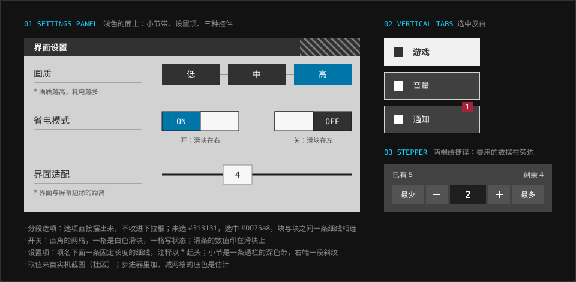

# 表单控件

> 选项摆在面上，不收进下拉框。每个控件都是一块直角的色块：选中的那块变蓝，其余是深色。

> 本篇的出处是实机的设置页与采购弹层，取值标「社区（实机截图）」：形状和颜色来自真实画面，尺寸是从截图量出来再折到 1280 × 720 的，会差几个像素。两张设置页的截图都是英文客户端的“游戏”一页，别的页签里有什么控件没有看到。官网上只有一个下拉（干员屏的语音切换），那一节是实测。禁用、焦点、报错这些状态在截图里见不到，是本仓库的估计。

## 特征拆解

**1. 选项摆出来。** 画质的低 / 中 / 高、帧率的 30 / 60，不是一个下拉框，而是并排的两三块，每块写一个选项。当前选中的那块是蓝色实底，其余是深色。块与块之间留一道缝，缝的正中有一条细线把它们串起来——看上去像一根轴上的几个档位。

**2. 开关是一条两格宽的块。** 一格是白色的滑块，另一格写着当前的状态。开着的时候，左格是蓝底的 `On`，滑块在右；关着的时候，滑块在左，右格是深色底的 `Off`。它没有圆头，也没有“小圆球在轨道里滑”的造型：就是一块白色的矩形从一边移到另一边，露出来的那一半告诉你现在是什么状态。

**3. 滑条的数值写在滑块上。** 轨道是一条很细的深色线；滑块是一块白色的矩形，当前的数值直接印在上面。不需要在旁边另放一个数字。

**4. 选中是换一块颜色。** 不打勾、不描边、不发光：选中的那块整块变蓝，文字仍是白的。这和按钮“悬停整块换色”、标签页“选中明暗对调”是同一条规则。

**5. 一项一行，项名带一条线。** 每个设置项占一行：左边是项名，名字下面一条固定长度的细线；右边是控件。需要解释时，在下一行用灰色小字写注释，以 `*` 起头。项名的线不随名字的长短变化，所以一列项名的右端是齐的。

**6. 小节是一条深色的带。** 同一类设置项归在一条通栏的深色带下面，带上是白色粗体的小节名，右端有一段斜纹。它是这一页里最重的横向元素，把长长的一列控件切成几段。

**7. 分类竖排在左边。** 设置的几个大类（游戏、音量、通知、账号、其他）排成左侧的一列页签，每块是图标加文字。当前的那块反白，见 [导航](navigation.md)。

**8. 数量用步进器，两端给捷径。** 购买时选数量，是一条五格的块：最少、减、数值、加、最多。数值在正中，用数据体；“最少”“最多”让人一步到头，不必连点。

**9. 整页是盖上去的一层。** 设置页不是一个新页面。它盖在主界面上：下面的整页被模糊并提亮，上面是一张浅色半透明的面。右上角有一个描边的按钮用来恢复默认。

## 规范

### 分段选项、开关、滑条

尺寸是 1280 × 720 下的像素。

| 控件 | 做法 | 可信度 |
| --- | --- | --- |
| 分段选项 · 每一块 | 约 `138 × 48px`，直角；文字居中、白色、常规字重 | 社区（实机截图） |
| 分段选项 · 未选 | 底色 `#313131` | 社区（实机截图取色） |
| 分段选项 · 选中 | 底色 `#0075a8`，文字仍是白的（对比度 5.1:1） | 社区（实机截图取色） |
| 分段选项 · 间隔 | 块与块之间约 `16–20px`，正中一条细线相连 | 社区（实机截图） |
| 开关 · 整体 | 约 `172 × 40px`，直角，分成等宽的两格 | 社区（实机截图） |
| 开关 · 滑块 | 白色（取色 `#f7f7f7`），占一格；开在右、关在左 | 社区（实机截图取色） |
| 开关 · 状态格 | 开：`#0075a8` 底、白字 `On`；关：深色底（`#313131` 上下）、白字 `Off` | 社区（实机截图取色） |
| 滑条 · 轨道 | 约 3px 高的深色细线（取色 `#1c1c1c`） | 社区（实机截图取色） |
| 滑条 · 滑块 | 约 `60 × 40px` 的白色矩形（`#f7f7f7`），数值用深色字写在正中 | 社区（实机截图） |
| 悬停 | 游戏内没有悬停。网页上照按钮的规则：未选的块悬停时整块换成白底黑字 | 估计 |
| 禁用 | 底色 `#333333`，文字 `#8d8d8d`，不响应操作；与 [按钮](buttons.md) 的禁用态相同 | 估计 |
| 焦点 | 外侧 2px 的高对比轮廓，离开控件 2px | 估计 |

### 设置项、小节、页面

| 项 | 做法 | 可信度 |
| --- | --- | --- |
| 项名 | 深色字；下面一条 1px 的线（取色 `#787878` 上下），长约 `300px`，不随名字变 | 社区（实机截图） |
| 注释 | 项名的下一行，灰色小字，以 `*` 起头；可以折行，宽度可以超过那条线 | 社区（实机截图） |
| 控件的位置 | 项名的右边，各行的控件左缘对齐 | 社区（实机截图） |
| 小节带 | 通栏，高约 `38px`，近黑（`#313131` 上下），白色粗体的小节名贴左，右端一段 45° 的斜纹 | 社区（实机截图） |
| 竖排页签 | 每块约 `200 × 78px`，石墨色的底加一圈浅色细边，图标 + 文字；选中反白；块与块之间约 `16px` | 社区（实机截图） |
| 恢复默认 | 页头右端，约 `208 × 40px`，深色半透明的底加一圈浅色细边，白字 | 社区（实机截图） |
| 页头 | 左端一块白底深色箭头的返回（约 `118 × 43px`），旁边一块更高的浅色标题块（图标 + 页面名） | 社区（实机截图） |
| 页面 | 浅色半透明的面，盖在模糊并提亮的主界面上 | 社区（实机截图） |

### 数量步进器

| 项 | 做法 | 可信度 |
| --- | --- | --- |
| 结构 | 五格连成一条：最少、`−`、数值、`+`、最多 | 社区（实机截图） |
| 最少 / 最多 | `#535353` 底白字的小块 | 社区（实机裁图） |
| 数值 | 居中，数据体 | 社区（实机截图） |
| 上下文 | 上面写单价和“已有 5”，下面写“剩余 4”：做决定要用的数都摆在步进器旁边 | 社区（实机截图） |
| 到头的状态 | 数值到了下限或上限，对应的两格变成禁用态 | 估计 |

### 下拉（官网，实测）

官网干员屏用一个下拉切换语音的语种。六屏里像表单控件的只有这一处。

| 项 | 值 |
| --- | --- |
| 整块 | `14.375rem × 2.75rem`，底色 `rgba(10,10,10,.9)`；左端是 `2.75rem` 宽的播放按钮 |
| 触发行 | 上面一行小标签 `CHARACTER VOICE`（Oswald Medium `0.75rem`，信号色），右端一个 `0.5rem` 宽的折线箭头 |
| 当前项 | 标签下面一行：黑底白字，思源黑体 Regular `0.875rem`，左缘 `4px` 的信号色边，左内边距 `0.75rem` |
| 展开的选项 | 接在整块的正下方、与右半同宽；**白底**，文字 `#666666`，上下内边距各 `0.5rem`，左缘留一条 `4px` 的透明边占位 |
| 选项悬停 | 文字变信号色，`transition: color .3s` |

当前项是深底浅字，展开的选项是浅底深字：下拉打开时，“已选的”和“可选的”在明暗上是反的。

```html
<div class="ark-seg" role="radiogroup" aria-labelledby="fps-label">
  <span id="fps-label">帧率</span>
  <label><input type="radio" name="fps" value="30"><span>30 FPS</span></label>
  <label><input type="radio" name="fps" value="60" checked><span>60 FPS</span></label>
</div>

<label class="ark-switch">
  <span>省电模式</span>
  <input type="checkbox" role="switch" checked>
  <span class="ark-switch__body" aria-hidden="true"></span>
</label>
```

```css
/* 分段选项：每块是一个单选框的外观 */
.ark-seg { display: flex; align-items: center; gap: var(--ark-space-4); }
.ark-seg label { position: relative; }
.ark-seg input { position: absolute; inset: 0; opacity: 0; }
.ark-seg label > span {
  display: grid; place-items: center; min-width: 8.5rem; min-height: 3rem;
  background: var(--ark-color-neutral-graphite-deep); color: var(--ark-color-neutral-white);
  transition: color var(--ark-motion-duration-base), background-color var(--ark-motion-duration-base);
}
.ark-seg label + label::before {            /* 块与块之间的那条线 */
  content: ""; position: absolute; right: 100%; top: 50%;
  width: var(--ark-space-4); height: var(--ark-line-hairline);
  background: var(--ark-color-line-hairline-strong);
}
.ark-seg input:checked + span { background: var(--ark-color-signal-info); color: #000; }
.ark-seg input:focus-visible + span { outline: 2px solid var(--ark-color-neutral-white); outline-offset: 2px; }

/* 开关：一格滑块、一格状态，开的时候两格对调 */
.ark-switch { display: flex; align-items: center; justify-content: space-between; gap: var(--ark-space-5); }
.ark-switch input { position: absolute; opacity: 0; }
.ark-switch__body {
  display: flex; width: 10.75rem; height: 2.75rem;
  background: var(--ark-color-neutral-graphite-deep); color: var(--ark-color-neutral-white);
  font: 700 var(--ark-font-size-label)/2.75rem var(--ark-font-family-data); text-align: center;
}
.ark-switch__body::before { content: ""; flex: 1; background: var(--ark-color-neutral-white); }
.ark-switch__body::after  { content: "OFF"; flex: 1; }
.ark-switch input:checked + .ark-switch__body {
  flex-direction: row-reverse; background: var(--ark-color-signal-info); color: #000;
}
.ark-switch input:checked + .ark-switch__body::after { content: "ON"; }
.ark-switch input:focus-visible + .ark-switch__body { outline: 2px solid var(--ark-color-neutral-white); outline-offset: 2px; }
```

示例里选中的颜色用的是 `--ark-color-signal-info` 配黑字，也就是官网主按钮的配法，换信号色时会跟着变。实机的 `#0075a8` 配白字没有对应的 token；要照实机做，把这两处换成 `#0075a8` 和白字即可，对比度是够的。

### 无障碍

- 用原生的 `<input>`：分段选项是一组 `radio`，开关是带 `role="switch"` 的 `checkbox`，滑条是 `range`，步进器的数值是 `number`。外观画在旁边的元素上，输入框本身只隐藏不移除。
- 选中不只靠颜色。开关有 `On` / `Off` 的字和滑块的位置；分段选项只有颜色这一种区别，实机也是这样——自己做的时候至少保证选中与未选的明度差得够大（`#0075a8` 对 `#313131` 只有 2.5:1，不够；示例里的青蓝对 `#313131` 是 7.2:1）。
- 点击区不小于 44 × 44px。实机的开关和滑块约 40px 高，照搬到网页上时把高度加到 44px，或者让整行都能点。
- 滑条的数值除了印在滑块上，还要能被读屏读到（`aria-valuetext`，或一个关联的 `<output>`）。
- 注释用 `aria-describedby` 挂到对应的控件上，不要只是摆在下面。

## 示意图



## 官方参考

| 看什么 | 链接 | 说明 |
| --- | --- | --- |
| 分段选项、开关的开与关、滑条、小节带、竖排页签 | [Terra Wiki 的 `UI-settingsmenu`](https://arknights.wiki.gg/wiki/File:UI-settingsmenu.png) | 1600 × 900 的整屏截图，英文客户端；能看到设置页是盖在主界面上的 |
| 同一页较新的截图 | [Terra Wiki 的 `UI-settingsmenu-1-2025`](https://arknights.wiki.gg/wiki/File:UI-settingsmenu-1-2025.png) | 1077 × 598；三选一的分段选项、帧率、滑条 |
| 数量步进器 | [《明日方舟》UI/UX 设计复盘](https://www.gcores.com/articles/123154) | 文中凭证交易所的兑换弹层截图 |
| “最少”“最多”的小块 | [MAA · resource/template](https://github.com/MaaAssistantArknights/MaaAssistantArknights/tree/dev-v2/resource/template) | 实机裁图 |
| 下拉 | [官网 · 干员](https://ak.hypergryph.com/#operator) | 名字下面的 `CHARACTER VOICE` |

## Do / Don't

| Do | Don't |
| --- | --- |
| 两三个选项直接摆出来 | 两三个选项也收进下拉框 |
| 选中整块换色 | 选中只加一个小勾或一圈细描边 |
| 开关做成直角的两格 | 圆头的胶囊开关、带光晕的滑块 |
| 数值写在滑块上，或紧贴着控件 | 让人拖完了去别处看数值 |
| 项名、控件、注释排成固定的三处 | 每个设置项各排各的 |
| 步进器两端给“最少”“最多” | 只给加减，大数量要连点几十次 |
| 做决定要用的数摆在控件旁边 | 让人退出去查库存再回来 |

## 组件库

[`packages/react`](../../packages/react) 里还没有这一篇对应的组件。现有的 `Tabs`（分段块）可以当作分段选项的外观参考，`Button` 的禁用态与焦点轮廓可以直接沿用。

## 来源

- 实机截图：Arknights Terra Wiki 的 `UI-settingsmenu`（1600 × 900）与 `UI-settingsmenu-1-2025`（1077 × 598）。2026-10-14 在站内把图画到 canvas 上，按行、按列扫颜色的分段来量各控件的边界并取色，再按屏高折到 720p。两张图里选中的蓝都是 `#0075a8`
- 数量步进器：[《明日方舟》UI/UX 设计复盘](https://www.gcores.com/articles/123154) 里的兑换弹层截图（2026-10-07 核对采购弹层时看的），“最少 / 最多”的取色来自 [MAA](https://github.com/MaaAssistantArknights/MaaAssistantArknights) 的实机裁图
- 下拉：官网样式表实测（2026-10-14）
- 对比度按 WCAG 2 的公式计算
