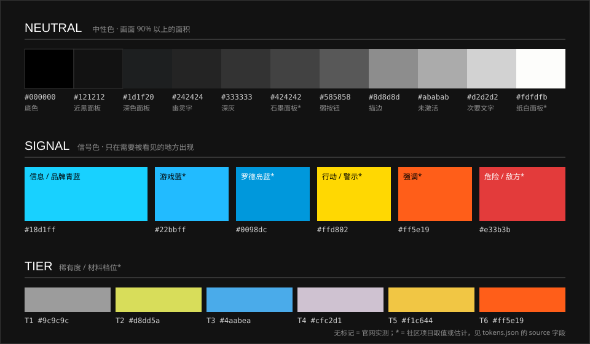

# 色彩

> 九成黑白灰，一成信号色。颜色不是装饰，是“这里有信息”的标记。

## 特征拆解

**1. 中性色构成画面主体。** 官网整站的底色是纯黑 `#000000`，其上叠加近黑到深灰的若干层（`#121212` → `#1d1f20` → `#242424` → `#333333`），文字用纯白与三档灰。游戏内则多一组浅色：纸白面板和石墨面板，两者一明一暗交替出现，形成主界面最有辨识度的“黑白拼块”。

**2. 只有一个主信号色。** 官网的青蓝 `#18d1ff` 在两份样式表里出现了 40 余次，其他任何彩色都不超过 2 次（首页右栏几个下载入口各自的品牌色）。它主要有两种用法：做**实心的底**，做**文字和图形的颜色**，前者略多；偶尔做左缘的一条边。具体位置见下面“青蓝用在哪”。游戏内的蓝更偏正蓝（社区常取 `#22bbff` 或更深的 `#0098dc`；设置页里选中的选项取色 `#0075a8`），角色相同。

**3. 黄与橙是“第二声部”。** 黄色用于警示与进度（警戒条纹、经验条、等级环、星级），橙色用于极小面积的高浓度强调（六星、提醒标记、限时、弹窗里要花掉的东西）。两者都不会与蓝色在同一个组件里平分面积。行动本身不是黄的：开始行动、编队确认、设置页里选中的选项都是蓝色实底。

**4. 颜色承担分类语义。** 稀有度、材料档位、基建设施类型、敌我阵营都用固定色编码，玩家在读文字之前已经读到了颜色：

| 语义 | 颜色 | 说明 |
| --- | --- | --- |
| 我方 / 信息 | 蓝 | 生命点数的图标、可部署格、我方血条 |
| 敌方 | 橙 | 作战顶部击杀计数的图标（取色 `#ff7800`） |
| 危险 | 红 | 生命点数的数字（浅红）、敌方进入时屏幕边缘的闪烁、警告 |
| 确认花费 | 暗红 | 弹窗与寻访的确认块（`#731111`） |
| 建设性的行动 / 选中 | 蓝 | 开始行动、编队与招募的确认、设置页里选中的选项与打开的开关 |
| 警示 / 进度 | 黄 | 警戒条纹、经验、等级环、星级 |
| 强调 | 橙 | 六星、提醒标记、限时角标、弹窗里的后果 |
| 基建·制造站 | 黄 `#ffcc00` | 设施类型色 |
| 基建·贸易站 | 蓝 `#33ccff` | 设施类型色 |
| 基建·发电站 | 黄绿 `#ccff66` | 设施类型色 |

> **2026-10-07 更正。** 这张表原先写“敌方 / 危险 = 红：敌人计数、费用不足、警告”“发电站 = 绿”。对实机截图取色之后：击杀计数的图标是橙色，不是红色；费用不足时部署卡上的数字是变灰，不是变红；发电站是黄绿。
>
> **2026-10-14 更正。** 第 3 条和这张表原先把“开始行动”“需要确认的操作”归在黄色名下，与 [按钮](../elements/buttons.md) 一篇对实机裁图的取色相反：开始行动是蓝底（`#0098dc`），弹窗的确认是暗红，建设性的确认是蓝。黄色在实机上见到的是进度与等级（经验条、等级环、星级）。第 2 条原先说青蓝“只出现在四类位置”，重新统计样式表后改写，见下。

**5. 几乎不用渐变色。** 出现的渐变只有两种：黑色到透明（给图片压字），白色到透明（细线一端渐隐）。色面本身永远是平涂。

**6. 低饱和的图 + 高饱和的标记。** 场景与立绘整体压低饱和度、压暗四周，UI 的信号色才能在其上跳出来。这是整套配色能成立的前提，详见 [图片](imagery.md)。

## 规范

色值的唯一来源是 [`tokens/tokens.json`](../../tokens/tokens.json)，下表为常用项。

### 中性色

| 用途 | 值 | Token | 可信度 |
| --- | --- | --- | --- |
| 页面底色 | `#000000` | `--ark-color-neutral-black` | 实测 |
| 近黑面板 | `#121212` | `--ark-color-neutral-ink-950` | 实测 |
| 深色面板 / 弹层 | `#1d1f20` | `--ark-color-neutral-ink-900` | 实测 |
| 幽灵标题字色 | `#242424` | `--ark-color-neutral-ink-850` | 实测 |
| 弱按钮底 | `#585858` | `--ark-color-neutral-gray-600` | 实测 |
| 描边 / 次要信息 | `#8d8d8d` | `--ark-color-neutral-gray-500` | 实测 |
| 未激活标题 | `#ababab` | `--ark-color-neutral-gray-400` | 实测 |
| 次要正文 | `#d2d2d2` | `--ark-color-neutral-gray-300` | 实测 |
| 主文字 | `#ffffff` | `--ark-color-neutral-white` | 实测 |
| 纸白面板（游戏） | `#fdfdfb` | `--ark-color-neutral-paper` | 社区 |
| 纸白面板上的文字 | `#323232` | `--ark-color-neutral-paper-ink` | 社区 |
| 石墨面板（游戏） | `#424242` | `--ark-color-neutral-graphite` | 社区 |
| 细分隔线 | `rgba(255,255,255,.3)` | `--ark-color-line-hairline` | 实测 |
| 强分隔线 / 描边 | `rgba(255,255,255,.5)` | `--ark-color-line-hairline-strong` | 实测 |

### 信号色

| 角色 | 值 | Token | 可信度 |
| --- | --- | --- | --- |
| 信息 / 品牌青蓝（官网） | `#18d1ff` | `--ark-color-signal-info` | 实测 |
| 信息（游戏内近似） | `#22bbff` | `--ark-color-signal-info-game` | 社区 |
| 深蓝 | `#0098dc` | `--ark-color-signal-info-deep` | 社区；开始行动按钮的实机裁图取色相同 |
| 更深的蓝（选中的选项、打开的开关） | `#0075a8` | — | 社区（实机截图取色）；ak-ui 的深蓝也是这个值。白字压在上面是 5.1:1 |
| 行动 / 警示黄 | `#ffd802` | `--ark-color-signal-action` | 社区 |
| 强调橙 | `#ff5e19` | `--ark-color-signal-accent` | 社区；与主界面实机截图取色一致 |
| 危险红 | `#e33b3b` | `--ark-color-signal-danger` | 社区 |
| 告警红（计数色块） | `#a32339` | `--ark-color-signal-alert` | 社区（实机截图取色） |
| 确认红（弹窗的确认块） | `#731111` | `--ark-color-signal-confirm` | 社区（实机裁图取色） |

### 青蓝用在哪

官网两份样式表里，写了青蓝的声明一共 46 条（2026-10-14 统计；其中 5 条写作 `#19d1ff`，只差一个色阶，肉眼分不出）。按属性分：

| 用法 | 条数 | 核对过的位置 |
| --- | --- | --- |
| 实心的底（`background-color`） | 23 | 主按钮（情报屏的“更多情报”、泰拉万象的“查看详情”）、新闻分类的当前项、轮播的进度段、标题组和图集说明下面的粗条、选中物件背后的方块、小导航里当前项填实的方框、时间轴里选中的年份、图集缩略图当前项的底条 |
| 文字与图形（`color`） | 17 | 导航的当前项与悬停、新闻行的分类、右栏计数的大数字、阵营切换的当前项（它左缘那条 `0.5rem` 的边跟着文字色走）、`CHARACTER VOICE` 标签与播放按钮、选中标注的字、`TIMELINE` 标签与当前的月份 |
| 左缘的一条边（`border-left`） | 4 | 语音下拉里当前的那一行（`4px`）；另外三处在几个二级页里 |
| 用边框拼的三角（`border-color`） | 2 | 干员屏缩略图当前项背后探出来的那个三角 |

没有逐条对到页面上的还有十来条，从选择器看在图集以外的几个二级页和顶栏、右栏弹出的层里。

另有一处 25% 的青蓝（设定条目悬停时浮出的巨字）和一处更浅的 `#7ee5ff`（播放按钮的悬停）。

规律是：**青蓝要么铺满一小块，要么只染一行字**，不做大面积的底，也不做渐变。同一屏里实心的青蓝通常只有一两块。

### 作战与基建的固定色

这两组是固定语义，不跟随可替换的信号色。

| 角色 | 值 | Token | 可信度 |
| --- | --- | --- | --- |
| 击杀计数的图标（橙） | `#ff7800` | `--ark-color-side-enemy` | 社区（实机截图取色） |
| 生命点数的数字（浅红） | `#e88080` | `--ark-color-side-life` | 社区（实机截图取色） |
| 制造站 | `#ffcc00` | `--ark-color-facility-factory` | 社区（实机裁图，纯色） |
| 贸易站 | `#33ccff` | `--ark-color-facility-trading` | 社区（实机裁图，纯色） |
| 发电站 | `#ccff66` | `--ark-color-facility-power` | 社区（实机裁图，纯色） |

生命点数图标上的蓝取色是 `#08a0f0`，和 `--ark-color-signal-info-deep`（`#0098dc`）很接近，没有另立一个 token。

### 稀有度 / 档位

| 档位 | 值 | Token | 可信度 |
| --- | --- | --- | --- |
| T1 灰 | `#9c9c9c` | `--ark-color-tier-1` | 社区 |
| T2 黄绿 | `#d8dd5a` | `--ark-color-tier-2` | 社区 |
| T3 蓝 | `#4aabea` | `--ark-color-tier-3` | 社区 |
| T4 淡紫 | `#cfc2d1` | `--ark-color-tier-4` | 社区 |
| T5 金 | `#f1c644` | `--ark-color-tier-5` | 社区 |
| T6 橙 | `#ff5e19` | `--ark-color-tier-6` | 估计 |
| 星级的黄 | `#f1d94a` | `--ark-color-tier-star` | 社区（实机截图取色） |

### 面积配比（估计）

| 层 | 占比 | 内容 |
| --- | --- | --- |
| 中性色 | 约 90% | 底色、面板、文字、线 |
| 主信号色 | 5–8% | 一屏内一到两处实心色块，其余为线与小字 |
| 次信号色 | 不超过 2% | 黄、橙、红，按语义出现 |

## 示意图

## 官方参考

| 看什么 | 链接 | 说明 |
| --- | --- | --- |
| 黑底 + 单一青蓝的整站配色 | [官网 · 首页](https://ak.hypergryph.com/#index) | 留意导航激活、右栏计数、轮播进度条是全屏仅有的彩色 |
| 青蓝实心按钮与分类标签 | [官网 · 情报](https://ak.hypergryph.com/#information) | “更多情报”按钮、新闻分类 |
| 游戏内黑白拼块与蓝色主行动 | [首页场景一览 · PRTS](https://prts.wiki/w/%E9%A6%96%E9%A1%B5%E5%9C%BA%E6%99%AF%E4%B8%80%E8%A7%88) | 场景截图中可见主界面面板的明暗关系 |
| 换主题后的配色变化 | [界面主题一览 · PRTS](https://prts.wiki/w/%E7%95%8C%E9%9D%A2%E4%B8%BB%E9%A2%98%E4%B8%80%E8%A7%88) | 同一套结构换色后依然成立 |

## Do / Don't

| Do | Don't |
| --- | --- |
| 先用黑白灰把层级做完，再点信号色 | 一上来就铺蓝色发光边框 |
| 一个组件里只出现一种信号色 | 蓝、黄、橙在同一张卡片里平分面积 |
| 用色的同时配上图标、文字或形状变化 | 只靠颜色区分状态 |
| 图片压字用黑色渐变遮罩 | 给色块本身做彩色渐变 |
| 悬停时前景与背景对调（如青蓝底黑字 → 白底黑字） | 悬停只改一点透明度 |

## 来源

- 官网样式表实测（2026-10-06）；2026-10-14 把写了青蓝的 46 条声明按属性分了类，逐条对到页面上的在“青蓝用在哪”一表里
- 游戏内的几个色值对实机截图取色核对（2026-10-07）：PRTS 的主界面截图、MAA 的模板图、机核文章里的实机截图、Arknights Terra Wiki 的作战截图
- 设置页选中项的蓝：Terra Wiki 的 `UI-settingsmenu`（1600 × 900）与 `UI-settingsmenu-1-2025`，两张取色都是 `#0075a8`（2026-10-14）
- [YunYouJun/ak-ui](https://github.com/YunYouJun/ak-ui) `src/scss/_variables.scss`、`_tokens.scss`
- [mashirozx/arknights-ui](https://github.com/mashirozx/arknights-ui) `css/styles.css`
- [Yue-plus/hexo-theme-arknights](https://github.com/Yue-plus/hexo-theme-arknights) `source/css/_core/color/`
- [从 TA 的视角看 UI #1——明日方舟美术设计分析](https://zhuanlan.zhihu.com/p/570566718)
