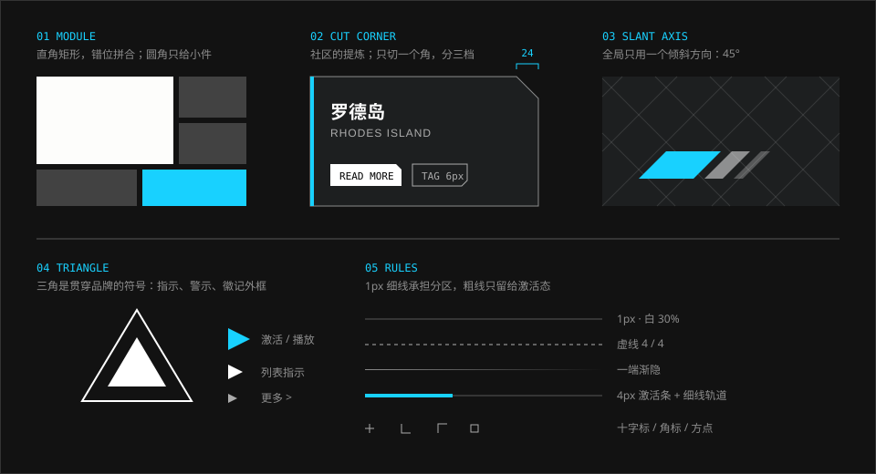

# 几何语言

> 直角矩形是基本单位，斜一条边、放一个三角，就够了。圆形和圆角是少数，但不是没有。

## 特征拆解

**1. 矩形是默认形状。** 面板、按钮、标签、头像框、进度条都是直角矩形。一篇改版练习的归纳很准：界面以矩形为主，辅以少量的圆形元素。圆形是等级环、快捷导航的节点、带加号的小按钮这类“一个点”的东西；圆角只出现在少数功能性的小件上，而且很小，清单见下面“圆角出现在哪”。相比同类游戏常见的大圆角与内发光，这种棱角分明的处理显得冷静、“不近人情”，这正是它的气质来源。

官网有一处很说明态度：它用的轮播库给滚动条默认加了 `10px` 的圆角，样式表里专门把它改回了 `0`。

**2. 错位拼合。** 矩形不排成整齐的等大网格，而是大小不一地拼在一起：一块大的配两三块小的，或一行三等分下面接一行两等分。块与块之间留很窄的缝。

**3. 切角是社区的提炼，要用就只切一个。** 切角（把矩形的一个角削掉）是社区项目（ak-ui 等）对这套风格的概括，用来强调“这是一个可操作的东西”或“这是一张卡”。它在原作里的出处很少：官网的样式表里没有 `clip-path`，实机的标签、按钮、面板上也没有见到削掉的角；最接近的是干员卡片名字带那条斜的上缘，和缩略图背后探出来的三角。所以切角是一个可选的点缀：用的时候**只切一个角**，四个角全切会变成另一种风格（更接近《终末地》或一般的科幻 HUD）。

**4. 只有一个倾斜方向。** 斜线统一是 45°：背景的对角线网格、警戒条纹、装饰用的平行四边形。官网样式表里的旋转值只有 `±45deg`，斜切只有 `skewX(45deg)`。

游戏内对实机截图核对之后（2026-10-07），有三处不走 45°，都不是界面的结构线：

- **干员卡片的名字带。** 那条近黑色带的上缘左高右低，量下来约 12°。它跟着立绘的构图走，像一道斜切的裁纸边。
- **售罄的章。** 斜盖在商品卡片上的暗红色带，量得 −11.8°。它是一枚印章。
- **关卡地图的连线。** 两个节点之间直连，角度由节点的位置决定。

另外，作战 HUD 的底板（顶部战况、右下角费用）原先写作“单边斜切”，实机是直角矩形。

**5. 三角是品牌母题。** 从游戏 Logo、职业图标到时装品牌标识，三角形反复出现。在界面里它承担三种职责：方向指示（播放、更多、当前项）、警示（配合黄色）、徽记外框（阵营标识）。

**6. 线比面多。** 分区主要靠 1px 细线完成，而不是给每个区域一个底色。粗线（4px、8px）只留给激活态和强调边。细线常常只画一段：一端渐隐，或者只有起点一小段是实的。

**7. 小方块与十字标。** 标注用一个空心的小方块，里面一道 45° 的斜杠（官网泰拉万象屏，实测）；角落放十字或 L 形角标（估计）。它们像图纸上的定位标记，暗示“这是一张工程图”。这与制作人的建筑学背景常被联系在一起：关卡里用白色体块表示建筑、用等高线表示山岭，同样是图纸语言。

## 规范

| 项 | 值 | Token | 可信度 |
| --- | --- | --- | --- |
| 默认圆角 | `0` | `--ark-radius-none` | 实测（官网的面板、按钮、标签、进度条都没有圆角） |
| 极小的圆角 | `2px`：官网标注的小方框、干员屏缩略图的滚动条 | `--ark-radius-subtle` | 实测 |
| 其余的圆角 | 没有 token。用到时照下面的清单取值，不要超过 `0.5rem` | — | 见“圆角出现在哪” |
| 切角 · 小 | `0.375rem`（标签、小按钮） | `--ark-cut-sm` | 社区 |
| 切角 · 中 | `0.75rem`（卡片） | `--ark-cut-md` | 社区 |
| 切角 · 大 | `1.5rem`（大面板） | `--ark-cut-lg` | 社区 |
| 倾斜角度 | `45deg`，官网全站唯一；游戏内有上面三处例外 | — | 实测（官网）；社区（实机截图） |
| 细线 | `1px` | `--ark-line-hairline` | 实测 |
| 激活条 | `4px` | `--ark-line-strong` | 实测 |
| 强调边 | `0.5rem` | `--ark-line-heavy` | 实测 |

```css
/* 右上角切角 */
.card {
  clip-path: polygon(
    0 0,
    calc(100% - var(--ark-cut-md)) 0,
    100% var(--ark-cut-md),
    100% 100%,
    0 100%
  );
}

/* 左侧强调边 */
.card { border-left: var(--ark-line-strong) solid var(--ark-color-signal-info); }

/* 方向三角 */
.arrow {
  width: 0; height: 0;
  border: 0.375rem solid transparent;
  border-left-color: currentColor;
}
```

> 官网样式表中没有使用 `clip-path`，切角和三角是用边框与旋转拼出来的。`clip-path` 是社区项目（ak-ui 等）的现代写法，效果等价。使用 `clip-path` 时注意：焦点轮廓会被一起裁掉，需要把轮廓画在外层容器上。

### 圆角出现在哪

官网样式表里全部的 `border-radius`（2026-10-14，除去轮播库自带的规则）：

| 位置 | 取值 | 说明 |
| --- | --- | --- |
| 轮播的进度段、几处滚动条 | `0` | 显式写的，为了盖掉轮播库默认的 `10px` |
| 标注的小方框、干员屏缩略图的滚动条 | `2px` | 小到只是把尖角磨掉 |
| 首页右栏的下载、社区、支付入口 | `0.25rem` | `10.5rem × 3rem` 的小按钮，各带自己的品牌色 |
| 同一组入口里带品牌色描边的那一层 | `0.375rem` | 描边是 50% 的品牌色 |
| 方形的小图标 | `3px`、`0.5rem` | `2.6rem`、`3.375rem` 见方 |
| 弹层（里面一张 330px 见方的图） | `8px` | 弹层和图都是 |
| 弹层的页头 | 只圆上面两个角，`0.625rem` | 高 `5.5rem` |
| 胶囊形的底 | 高 `1.5rem`、半径 `0.75rem` | 全站只有一处 |

后面六行从选择器和内容看，都是下载、扫码、跳转别的平台用的入口和它们弹出的层（比如“模拟器下载”的那一层），没有一处在六屏的骨架和内容上。

实机截图里见到的（社区，实机截图）：

| 位置 | 形状 |
| --- | --- |
| 等级环、快捷导航的节点、资源条的加号、信息按钮 | 圆 |
| 基建总览的房间卡片、采购中心的商品卡片 | 很小的圆角 |
| 购买弹层的“总计支付”、主界面的限时标记、公开招募里的“时间”小标签 | 圆头（胶囊形） |
| 基建里“有待处理”的气泡、干员头像上的加成 | 圆 |

规律有两条：

- **骨架上的东西是直角。** 面板、行动按钮、标签页、弹窗、进度条、分隔线，没有例外。
- **圆角留给“外来的”和“可以拿走的”。** 下载入口和它们弹出的层通向别的平台；商品卡片、房间卡片是一件件的物品；圆头的小标签是贴在别的东西上的一枚标记。它们用圆角把自己和骨架区分开。这一条是本仓库的归纳，不是官方的说法。

> **2026-10-14 更正。** 这一篇原先写“整套界面几乎找不到圆角”，规范里“允许的最大圆角 2px”标的是社区取值。把官网样式表的 `border-radius` 逐条列出来之后：2px 在官网有实测的出处，另有七八处更大的圆角，都不在骨架上。实机的卡片和圆头按钮在前几轮核对组件时已经见到，当时没有回头改这里的措辞。

### 切角位置约定（估计）

| 元素 | 切哪个角 | 理由 |
| --- | --- | --- |
| 卡片 / 面板 | 右上 | 左侧留给强调边和标题 |
| 弱按钮 / 标签 | 右上或右下 | 指向阅读方向的末端 |
| 返回 / 主页按钮 | 不切、不斜 | 实机里是两个并排的直角矩形，见 [导航](../elements/navigation.md) |

## 示意图



## 官方参考

| 看什么 | 链接 | 说明 |
| --- | --- | --- |
| 45° 对角线网格、方格 | [官网 · 设定](https://ak.hypergryph.com/#world) | 背景的斜线网格最清楚 |
| 阵营三角徽记、缩略图条 | [官网 · 干员](https://ak.hypergryph.com/#operator) | 干员名右侧的三角标识 |
| 带斜杠的小方框 | [官网 · 泰拉万象](https://ak.hypergryph.com/#media) | 场景里每个物件旁的标注；左上角小导航里也是小方框 |
| 条带切图、图标 + 标题组 | [官网 · 更多内容](https://ak.hypergryph.com/#more) | 四条等宽竖带 |
| 三角母题在品牌标识中的延续 | [我在明日方舟里面学平面设计](https://zhuanlan.zhihu.com/p/145684354) | 时装品牌 Logo 的拆解 |

## Do / Don't

| Do | Don't |
| --- | --- |
| 骨架上的东西一律直角 | 给面板、行动按钮、标签页加圆角 |
| 圆角只给小件，不超过 `0.5rem` | 给卡片加 8px 以上的圆角，或把所有按钮做成胶囊 |
| 一个组件最多切一个角 | 四角全切、再加斜边、再加编号 |
| 全局统一用 45° | 混用 30°、60°、15° 等多种斜度 |
| 用 1px 细线分区 | 给每个区域套一个描边盒子 |
| 三角用于指示方向或标记状态 | 把三角当成随处可贴的装饰 |
| 大小不一的矩形错位拼合 | 等大卡片排成均匀网格 |

## 来源

- 官网样式表实测（2026-10-06）；2026-10-14 列出全部 `border-radius`，并确认样式表里没有 `clip-path`
- 实机里的圆与圆角：机核文章里的基建总览与购买弹层截图、PRTS 的主界面截图、Terra Wiki 的公开招募截图（`UI-recruitment`）
- [尝试优化《明日方舟》官方网站的设计](https://www.gcores.com/articles/135723)（“以矩形为主，辅以少量的圆形元素”）
- [ak-ui · Design language](https://ak-ui.yyj.moe/en/guide/design-language.html)（切角、非对称几何）
- [明日方舟 UI 图案以及 LOGO 的设计是什么美术风格？](https://www.zhihu.com/question/489842081)（矩形、单色几何 Logo、半调）
- [从 TA 的视角看 UI #1](https://zhuanlan.zhihu.com/p/570566718)（关卡的白模与等高线）
